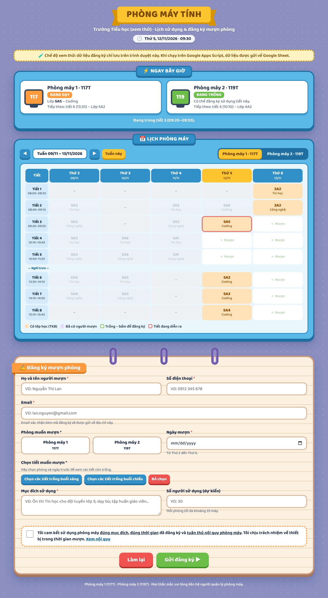

# Đăng ký phòng máy tính

Web xem lịch và đăng ký mượn **Phòng máy 1 (117T)** và **Phòng máy 2 (119T)**.

- Xem thời khóa biểu theo tuần, biết phòng nào đang có lớp học.
- Đăng ký mượn theo tiết, hoặc theo **giờ cụ thể** trong khung ngoài giờ học (**Nghỉ trưa** 11:25–13:35, **Cuối giờ học** 15:45–17:30).
- Nếu trùng với lớp học, CLB hoặc người mượn khác thì web báo lỗi.
- Phiếu đăng ký được lưu vào Google Sheet, kèm email xác nhận cho người mượn.

## Cấu trúc
| File | Vai trò |
|---|---|
| `index.html` | Giao diện chạy trên GitHub Pages. Gọi tới Apps Script qua biến `SCRIPT_URL` |
| `apps-script/Code.gs` | Phần xử lý trên Google Apps Script (gắn với Google Sheet) |
| `apps-script/Index.html` | Giao diện khi mở trực tiếp bằng link Apps Script (`/exec`) |

## Đổi link Apps Script
Trong `index.html`, tìm dòng `const SCRIPT_URL = '...'` và thay bằng link Web app (đuôi `/exec`).
Web app phải được triển khai với **Execute as: Me** và **Who has access: Anyone**.

## Quản lý
- Hủy lượt mượn: trong trang **DangKy** của Google Sheet, chọn Trạng thái **"Đã hủy"**.
- Đổi thời khóa biểu: sửa trang **TKB** trong Google Sheet.
- Khung ngoài giờ: là dòng **Nghỉ trưa** và **Cuối giờ học** trong trang TKB. Sửa cột Bắt đầu/Kết thúc để đổi giờ.
  Trong ô của khung này ghi `CLB` (chiếm cả khung) hoặc `CLB Robotics 16:00–17:00` (chỉ chiếm khoảng giờ đó).
